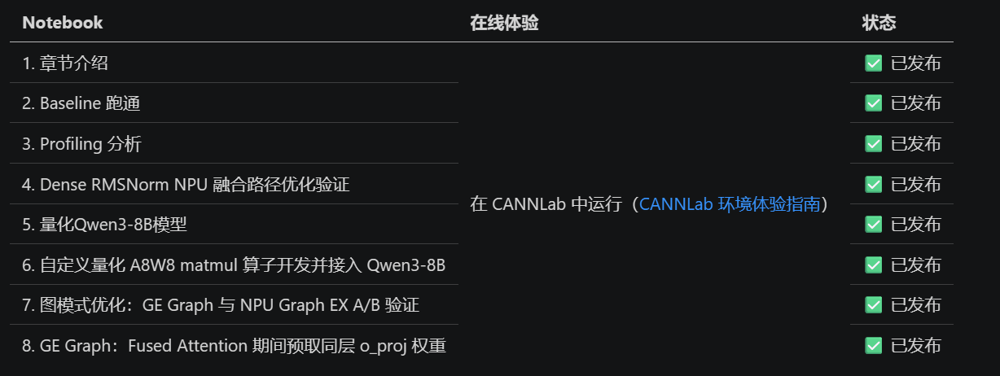
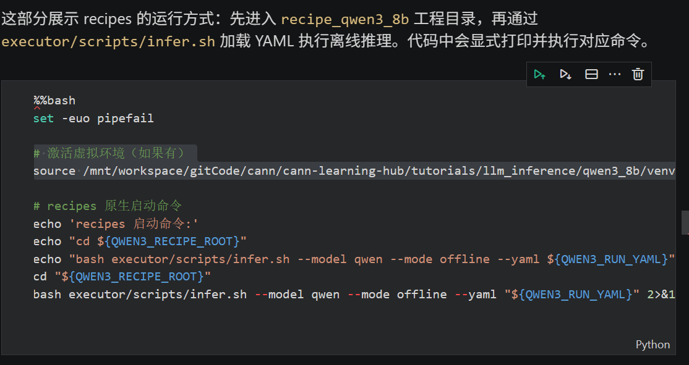

+++
date = '2026-10-14T20:13:41+08:00'
draft = false
title = '【CANN训练营】Qwen3-8B 推理优化实践食用指南'
categories = ["技术"]
tags = ["Qwen3-8B", "学习笔记"]
series = ["CANN训练营"]
+++

## 课程内容

课程资源：[cann-learning-hub/tutorials/llm_inference/qwen3_8b · CANN/cann-learning-hub - AtomGit](https://gitcode.com/cann/cann-learning-hub/tree/master/tutorials/llm_inference/qwen3_8b "cann-learning-hub/tutorials/llm_inference/qwen3_8b · CANN/cann-learning-hub - AtomGit")

这个课程用 Qwen3\-8B 模型，教你在昇腾 NPU 上做这几件事：

1.  用 cann-recipes-infer 框架跑通推理和性能分析，验证 Dense RMSNorm 融合路径的效果
2.  用 AMCT 工具做 W8A8 量化，并开发自定义量化matmul算子
3.  对比三种执行模式（Eager、GE Graph、NPU Graph EX），并在 GE 图模式下验证 Fused Attention 预取权重的收益

整个流程按 recipes 的标准用法走：先改 models/ qwen /config/ 下的 YAML 配置，再用 executor/scripts/infer.sh 启动推理，最后从 res/ 和 prof/ 目录看结果。

主要就是看课程里的readme，一步步跟着notebook的内容运行代码。

大部分内容都可以看qwen3_8b/README.md，里面写的非常详细。这篇文章主要讲一下容易遇到的问题，和实践过程中的笔记内容。

## 环境启动

主要有两种方式：

### 1\. CANNLab（推荐）

就是云环境，有100小时的免费使用时长，也是比较推荐的，具体配置看下面：

[cann-learning-hub/docs/CANNLab_env_experience_guide.md-代码预览-cann-learning-hub:基于 CANN 生态的学习中心项目 - AtomGit](https://gitcode.com/cann/cann-learning-hub/blob/master/docs/CANNLab_env_experience_guide.md "cann-learning-hub/docs/CANNLab_env_experience_guide.md-代码预览-cann-learning-hub:基于 CANN 生态的学习中心项目 - AtomGit")

### 2\. 本地部署

这个需要有昇腾 NPU，CANN9.0.0以上。

```cobol
git clone https://gitcode.com/cann/cann-learning-hub.git
cd cann-learning-hub
```

## 创建虚拟环境并安装配置

最好把工作目录放到 qwen3_8b 下。

在实验之前，建议先创建 虚拟环境 。

```bash
# 创建虚拟环境（python要求3.11及以上）
python3 -m venv venv
 
# 激活虚拟环境
source venv/bin/activate
 
# 安装依赖
pip install -r requirements.txt
```

requirement.txt补上这几个依赖：

```cobol
pyarrow==21.0.0
decorator==5.2.1
attrs==25.3.0
psutil==7.0.0
protobuf==6.31.0
```

由于jupyter notebook需要启用内核，还需要注册notebook内核并切换：

```csharp
# 查看当前内核
jupyter kernelspec list
 
# 如果虚拟环境内核未注册，手动注册
python -m ipykernel install --user --name=venv --display-name="Python (venv)"
```

环境准备就结束了，可以开始实验了。

### 实验

实验的顺序是01_chapter_intro.ipynb开始，一个个运行下来。

01_chapter_intro.ipynb主要是课程章节介绍，实验内容从02_baseline_inference.ipynb开始。



（来自README.md）

有个需要注意的地方：

%%bash 开头的脚本，最开始要加一行source &lt;path_to_your_venv_active_file&gt;，启动虚拟环境，例如：



### 其他

[【CANN训练营】Qwen3-8B 推理优化实践笔记（2~3）](https://blog.csdn.net/Coyilla/article/details/167913567?spm=1011.2124.3001.6209)
