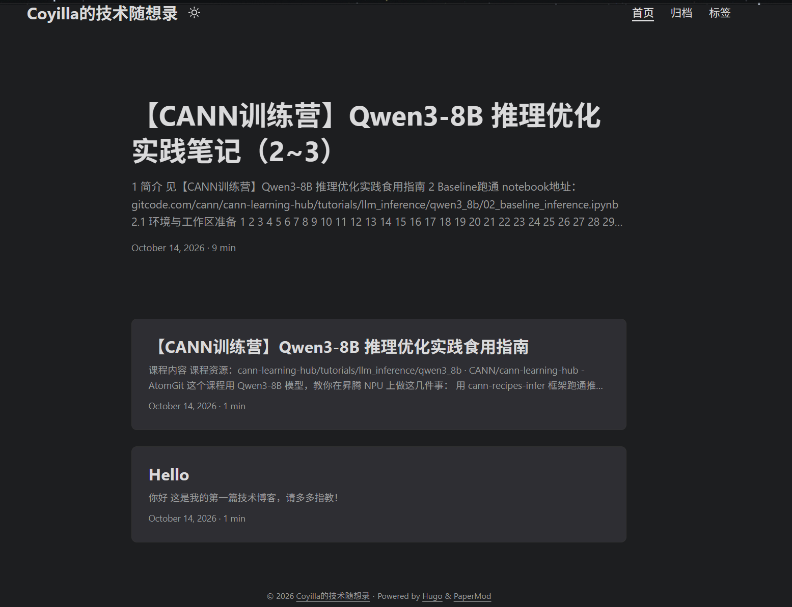

+++
date = '2026-10-14T23:05:01+08:00'
draft = false
title = '个人博客搭建记录'
+++
# 开始

这篇文章记录一下我搭建博客时踩过的坑...

## 1. 为什么选 Hugo
因为我想要一个**轻量级、快速、易于部署**的博客系统。Hugo 是一个静态网站生成器，它可以将 Markdown 文件转换为 HTML 页面，生成的页面可以直接部署到 GitHub Pages 上，非常适合个人博客。

## 2. 为什么选 PaperMod 主题
PaperMod 是一个简洁、现代的 Hugo 主题，支持暗黑模式、响应式设计、代码高亮等功能，非常适合技术博客。它的配置也比较简单。

## 3. 部署到 GitHub Pages
我选择将博客部署到 GitHub Pages，这样可以免费托管我的博客，并且可以通过 GitHub Actions 实现自动部署。每次我提交新的文章，GitHub Actions 会自动构建并部署我的博客，非常方便。

## 4. 遇到的问题

## 5. 搭建记录

### 2026-10-14 开始搭建
这一天，我闲着无聊，开始写CANN训练营的技术文章。既然文章都写好了，就萌生了一个想法：为什么不自己搭建一个博客，把这些文章都放上去呢？于是，我开始了我的博客搭建之旅。  
这个想法已经在我脑海里盘旋了很久，2026年10月，终于开始了。  

主要完成任务：
- 搭建博客基础雏形，采用Hogo+PaperMod，完成带主页+目录的博客，成功部署到github上并准备好了域名
- 发表4篇文章作为试水
- 添加了bing的站点，现在bing上已经可以搜到博客了
- 发现别人的博客好好看...我也想要...慢慢做吧
- 起了个好听的名字：Coyilla的技术随想录
- 在想一些不那么技术的事：把binggo之争放上来

附一张最初的博客，希望以后能坚持更新，改头换面

