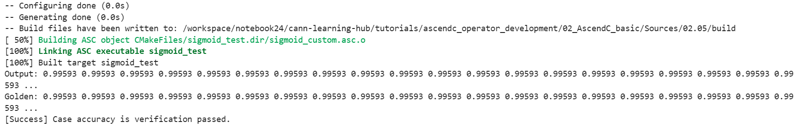
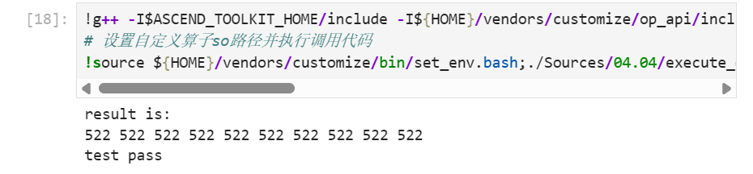
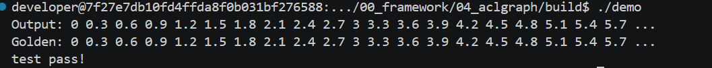

+++
date = '2026-10-15T10:49:27+08:00'
draft = false
title = '【CANN训练营】课堂笔记'
categories = ["技术"]
tags = ["学习笔记","记录"]
series = ["CANN训练营"]
+++
# day1上午 CANN基础
## PART1 人工智能基础
### 人工智能起源
- 图灵测试 图灵
- 达特茅斯会议 麦卡锡
### 人工智能发展
从“感知理解世界”向“生成创造世界”扩展  

- 上世纪 达特茅斯会议
- 1997 深蓝机器人战胜人类
- 2015 视觉识别超过人类
- 2020 蛋白质检查
- 2023 chatgpt出现
### 概念理解：人工智能、机器学习和深度学习
### 人工智能核心三要素：数据+算法+算力
- 算力：身体  
- 算法：大脑  
- 数据：粮食  
### 算法理论基础：业务抽象成数据模型的表达式
建模-训练-微调-推理
### 神经网络算法的发明是现代人工智能的开端
模拟神经元  
权重-激活-状态  
基于向前传播和向后传播的神经网络开启了现代AI的大发展  
### 神经网络——2012年ImageNet取得巨大突破，被往返认为现代AI的开始
海量数据+神经网络算法+大算力=现代AI  
### 概念理解：训练和推理
- 开发态-AI训练：通过大量数据学习“规则”形成模型/算法  
- 部署态-AI推理：利用已经训练好的“规则”完成具体任务
### 从算法为中心到以数据为中心，是AI大模型所带来的重大范式转移
AI=Code+Data  
数据的质量，决定了算法性能的上限。
### 人工智能概念：计算图、算子
计算图本质上是一个有向图，由节点（Node）和边（Edge）组成  
子（Operator，简称 Op）是计算图中的基本计算单元
### 算子
- 算子名称
- 算子裂隙
- 数据容器：张量
### 张量
Tensor是存储算子输入数据与输出数据的容器
- 名称 name
- 形状 shape
- 数据类型 dtype
- 数据排布格式 format：4D格式
### 小结
AI模型=计算图=算子组合->
## PART2  什么是NPU
### 为什么要NPU
1. 计算密集。计算任务大，操作逻辑简单
2. 数据并行。操作独立，可同时处理
3. 低精度可接受。AI对计算误差有较高容忍度。使用半精度或整数即可获得足够好的结果
### 昇腾NPU：AI计算的发动机
华为昇腾AI芯片，采用达芬奇架构，集成超大规模的计算单元，是支撑AI全场景应用的核心硬件基础
### CPU vs NPU：算力差距有多大
16*16矩阵：
- CPU: 16 * 16 * 16 * 2
- Vector：16 * 16
- Cude：1
### 异构计算：让专业硬件干专业的事
- cpu：系统的指挥中心
- npu：ai的超级工人和专职计算手
### Host与Device
### 硬件产品介绍
昇腾AI处理器系列
### 昇腾AI处理器抽象硬件架构
每个AI处理器包含多个AI Core，AI Core包含：
- 计算单元：标量计算单元，向量计算单元，矩阵计算单元
- 存储单元：Global Memory，Local Memory
- 搬运单元：DMA
### AIcore内部并行架构抽象
- 异步指令流
- 同步信号流
- 计算数据流
### 多核并行
单张NPU集成多个AI Core，通过任务拆解，让多个计算核心并行工作
算子计算时：
1. Tiling数据拆分
2. 多核并行计算
3. 隐式同步
### 昇腾NPU vs NVIDIA GPU架构对比
## PART3 什么是CANN
### CANN:对上适配AI框架，对下驱动NPU硬件
### CANN助力构建昇腾AI算力平台
架构：
- 运行时层（底层）：运行时，驱动
- 编程与编译（中间层）：算子编程，毕昇编译器
- 加速库（上层）：算子库（Ops-nn,ops-math），通信库（hixl,shmem,hccl），领域加速库（sip），图引擎（ge,metadef,graph-autofusion）
### 组件详解1-框架适配层：无缝对接AI昇腾
目标是实现上层AI架构与昇腾NPU的无缝融合
### 组件详解2-加速库之算子库：AI计算的“标准件仓库”
1. ops-math
2. ops-nn
3. ops-cv
4. ops-transformer
5. 支持自定义算法扩展
### 组件详解3-加速库之通信库：多卡协同
- HCCL集合通信
- HIXL单边通信
### 组件详解4-加速库之图引擎GE：全局优化的智慧大脑
1. 图编译：通过算子融合减少通信开销，自动编译算子执行顺序形成流水线
2. 图执行：算子图下沉
### 组件详解5-加速库之领域加速库
### 组件详解6-编译与编程：Ascend C
构建多层级API，支撑多维场景算子开发诉求
- 语言扩展层C
- C++（Tensor API,基础API，高阶API，Ascend）
- PyAsc
### 组件详解7-编译器、运行时与驱动
- 毕昇编译器
- 运行时
- 驱动
### 实战演练
output=torch.matmul(a.npu(),b.npu())
1. 框架适配（torch_npu）
2. 算子映射与图捕捉
3. 编译优化（GE+毕昇）
4. 硬件执行与结果就绪
### 横向对比：CANN vs CUDA
## PART4 NPU实践
### 核心工具库介绍
pytorch，torch_npu
### 检查NPU可用性
torch.npu.is_available()  
torch.npu.device_count()  
torch.npu.get_device_name(0)  
### 实践题
见https://gitcode.com/cann/cann-learning-hub#cann-basics

# day1下午 大语言模型基础
## Transformer架构
分词，词向量，自注意力，注意力机制，Softmax，多头注意力机制，前馈神经网络，Add&Norm，输出层
## 大语言模型核心架构演进
- DenseNetwork
- MoE
- MLA
- DSA
- GatedDeltaNet
- DiT
- Hybrid Model
### DenseNetwork:Llama
优化点：rmsnorm，SwiGLu，GQA
### MoE
用一组系数激活的专家网络替换了传统Transformer中的密集FFN层。
### MLA
对key和value做压缩，减少缓存占用，同时尽量不影响推理能力
### DSA
闪电索引+Top-k稀疏筛选
### GatedDeltaNet
融合门控机制+Delta更新规则的线性注意力变体架构
## 实践：DeepSeek V3.1推理网络在torch_npu上的构建实践
### DeepSeek v3.1网络架构解读
核心创新点：
- Attention机制是哦那个MLA架构  
- FFN前馈网络使用了DeepSeekMoE架构  

网络结构图：算子拆分

# day2 大语言模型基础从文本到推理系统
课件：见课表

https://gitcode.com/cann/cannbot-skills
大家可以去这个仓库里下 skills 安装到自己的 Agent 里

本次课程所有的 PPT 都可以从 https://gitcode.com/cann/cann-learning-hub/tree/master/standard_course/01_bootcamp/two_weeks_course 这个目录里下载，需要回看的同学去这里就好

同时，Cann-Learning-Hub：https://gitcode.com/cann/cann-learning-hub/tree/master/ 是我们精心打造的知识仓库，里面有大量的PDF、PPT、MD文档。有兴趣的同学可以翻找一下，肯定有你想要的东西，管够。

# day3 大模型量化基础

课件：见课表

产出：

https://coyilla.github.io/posts/tech/2026_10_cann_qwen3_8b_1

https://coyilla.github.io/posts/tech/2026_10_cann_qwen3_8b_2_3

# day4上午 异构计算与Ascend C算子编程导论
课件：

https://gitcode.com/cann/cann-learning-hub/blob/master/standard_course/01_bootcamp/two_weeks_course/06_a2a3_heterogeneous_computing_and_ascend_c_operator_programming_introduction.pptx  

课程：

https://gitcode.com/cann/cann-learning-hub/tree/master/tutorials/ascendc_operator_development_light

# day4下午 02-Ascend C SIMD 算子编程模型介绍

课件：

https://gitcode.com/cann/cann-learning-hub/blob/master/standard_course/01_bootcamp/two_weeks_course/07_a2a3_ascend_c_simd_programming_model.pptx  

收到CANN挑战赛的参赛通知，这个题目居然只剩两天了就截止了  
https://competition.gitcode.com/competition/2094721134930419714/intro

产出：

https://coyilla.github.io/posts/tech/2026_10_cann_ascend_c_basic_note

# day5 03-Ascend C Memory 矢量算子开发

课件：

https://gitcode.com/cann/cann-learning-hub/blob/master/standard_course/01_bootcamp/two_weeks_course/08_a2a3_ascend_c_simd_memory_vector_operator_programming.pptx 

下午：

做sigmoid的算子开发

简单版：https://gitcode.com/cann/cann-learning-hub/tree/master/tutorials/ascendc_operator_development 2.5 

困难版：https://gitcode.com/cann/cann-learning-hub/tree/master/tutorials/ascendc_operator_development_light 2.9

参考
https://www.hiascend.com/document/detail/zh/canncommercial/700/operatordev/Ascendcopdevg/atlas_ascendc_10_0006.html

发现：
`AscendC::Duplicate<float>(yLocal, (float)1, this->tileLength);
AscendC::Div(yLocal, yLocal, xLocal, this->tileLength);`和`AscendC:Reciprocal(yLocal, xLocal, this->tileLength);`计算结果不一样。

原因：
Div(1, x) 是真除法，Reciprocal(x) 是近似倒数。数学上等价，但精度和性能不同。

写了半天才写出来，纪念一下：
 

# day6上午 Ascend C 矩阵类算子编程
课件：

https://gitcode.com/cann/cann-learning-hub/blob/41e768012608f2104efc3f271ff9ddae9bc8c8b4/standard_course/01_bootcamp/two_weeks_course/10_a2a3_ascend_c_simd_matrix_operator_programming.pptx

习题：

https://gitcode.com/cann/cann-learning-hub/tree/master/tutorials/ascendc_operator_development

第四章矩阵算子开发

同样，记录一下


# day7 Ascend C 融合算子编程
课件：

https://gitcode.com/cann/cann-learning-hub/blob/master/standard_course/01_bootcamp/two_weeks_course/09_a2a3_ascend_c_simd_fused_operator_programming.pptx

https://gitcode.com/cann/cann-learning-hub/tree/master/tutorials/ascendc_operator_development/05_fused_operator_development

https://gitcode.com/cann/cann-learning-hub/blob/master/tutorials/ascendc_operator_development_light/03_simple_operator_practice/README.md

上午：已签到  
下午：已签到

实践题目：
https://cannjudge.cn/hz_cann/hzdz/matmul_sinh

# day8 Ascend C 调试调优与最佳实践
课件：https://gitcode.com/cann/cann-learning-hub/blob/master/standard_course/01_bootcamp/two_weeks_course/12_a2a3_ascend_c_operator_debugging_tuning_and_best_practices.pptx

上午：已签到  
下午：已签到

git clone https://gitcode.com/comic97/asc-devkit.git

mindstdio  
https://www.mindspore.cn/mindstudio/docs/zh-CN/82RC1/overview.html

浏览器://tracing

# day9 Ascend C 算子的PyTorch单算子调用
课件：https://gitcode.com/cann/cann-learning-hub/blob/master/standard_course/01_bootcamp/two_weeks_course/14_a2a3_ascend_c_operator_pytorch_single_operator_call.pptx

上午：已签到  
下午：已签到 


# day10 09-Ascend C 算子入图
课件：https://gitcode.com/cann/cann-learning-hub/blob/master/standard_course/01_bootcamp/two_weeks_course/15_a2a3_ascend_c_operator_graph_integration_pytorch_aclgraph_ge.pptx

上午：已签到  
下午：已签到

实践内容：
https://gitcode.com/cann/asc-devkit/blob/master/examples/01_simd_cpp_api/02_features/00_framework/04_aclgraph/README.md



期间遇到一个问题：  
用 cmake -DCMAKE_ASC_ARCHITECTURES=dav-2201 ... 配置后执行 make，bisheng 编译器报错：
LLVM ERROR: PlugIn Error: no aicore arch specified.
即编译命令中缺少 --npu-arch=dav-2201 参数。

根因  
CMAKE_ASC_ARCHITECTURES 的自动注入机制未被触发。按官方设计，CMake 应在 NPU 运行模式下自动把该变量转换为 --npu-arch=<value> 传给 bisheng，但实际未生效（可能与 find_package(ASC) 的变量读取时机、运行模式或项目 CMakeLists 的覆盖逻辑有关）。结果编译命令只有 --asc-aicore-lang，缺少架构参数。

解决方案
在 CMakeLists.txt 中手动为源文件强制注入编译参数，绕过自动机制：
```
cmake
set_source_files_properties(add.asc PROPERTIES
    COMPILE_FLAGS "--npu-arch=dav-2201"
)
```


# day11 cannbot
上午：已签到  
下午：已签到

# day12 softmax优化实践

https://gitcode.com/xujiachen8/softmax-demo-dav2201-practise

上午：已签到  
下午：已签到  

https://gitcode.com/xujiachen8/softmax-demo-dav2201-practise  
https://cannjudge.cn/public/vector/softmaxrowfp32  
https://gitcode.com/?tn=cannlab-environment  
https://asc.gitcode.com/api/SIMD-API/basic_api/memory_vector_compute/SIMD_compute/overview.html

# day13 matmul
上午：已签到  
https://gitcode.com/cann/ops-nn/wiki/MatMul%E7%AE%97%E5%AD%90%E6%80%A7%E8%83%BD%E4%BC%98%E5%8C%96%E5%AE%9E%E8%B7%B5%E4%B8%8E%E6%95%88%E6%9E%9C%E5%88%86%E6%9E%90.md

