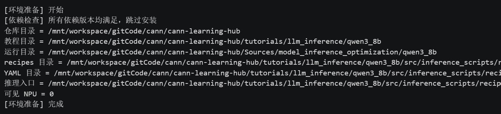
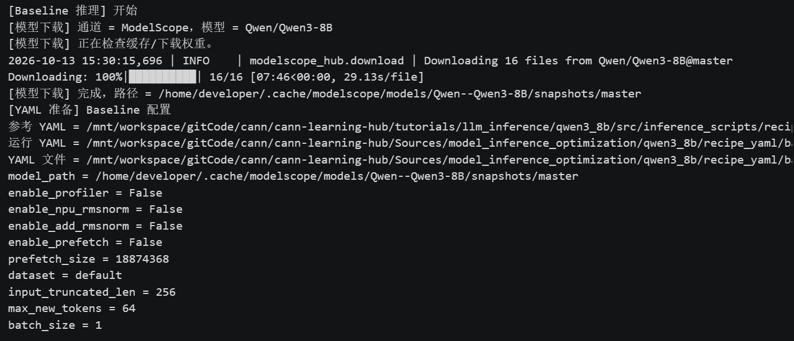
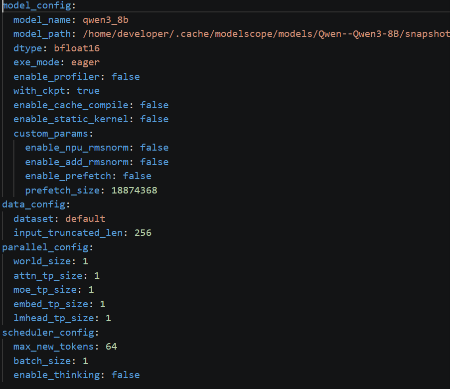
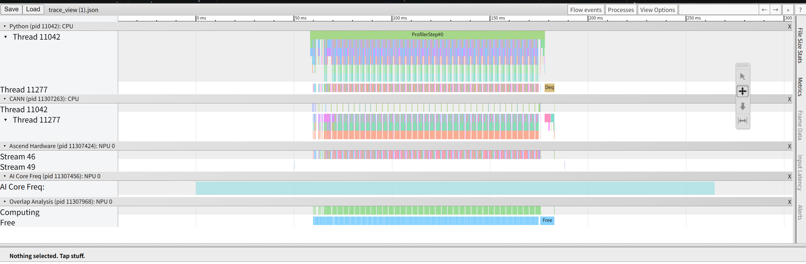
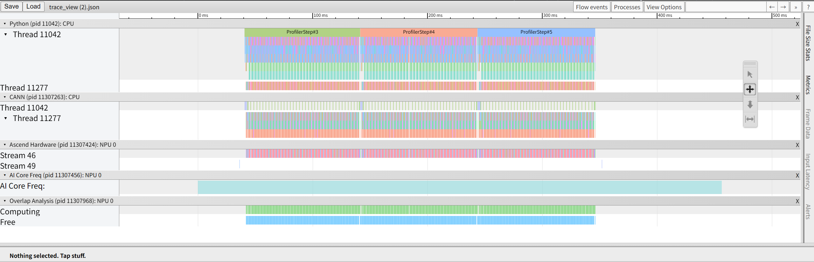

+++
date = '2026-10-14T22:38:38+08:00'
draft = false
title = '【CANN训练营】Qwen3-8B 推理优化实践笔记（2~3）'
categories = ["技术"]
tags = ["Qwen3-8B", "学习笔记"]
series = ["CANN训练营"]
+++

# 1 简介

见[【CANN训练营】Qwen3-8B 推理优化实践食用指南](https://coyilla.github.io/posts/tech/2026_10_cann_qwen3_8b_1/)

# 2 Baseline跑通

**notebook地址**：gitcode.com/cann/cann-learning-hub/tutorials/llm_inference/qwen3_8b/02_baseline_inference.ipynb

## 2.1 环境与工作区准备

```python
import json
import os
import subprocess
import sys
from pathlib import Path
 
print('[环境准备] 开始', flush=True)
os.environ.setdefault('QWEN3_8B_DOWNLOAD_BACKEND', 'modelscope')
os.environ['TOKENIZERS_PARALLELISM'] = 'false'
os.environ.setdefault('ASCEND_RT_VISIBLE_DEVICES', '0')
 
def locate_repo_root():
    repo_roots = []
    for env_name in ('GITCODE_REPO_ROOT', 'CANN_LEARNING_HUB_ROOT', 'REPO_ROOT'):
        if os.environ.get(env_name):
            repo_roots.append(Path(os.environ[env_name]))
    try:
        cwd = Path.cwd()
        lineage = [cwd, *cwd.parents]
        repo_roots.extend(lineage)
        repo_roots.extend(base / 'cann-learning-hub' for base in lineage)
        for base in lineage:
            try:
                repo_roots.extend(base.glob('*/cann-learning-hub'))
            except OSError:
                pass
    except FileNotFoundError:
        pass
    repo_roots.append(Path('/opt/atomgit/cann-learning-hub'))
 
    seen = set()
    for repo_root in repo_roots:
        key = str(repo_root)
        if key in seen:
            continue
        seen.add(key)
        if (repo_root / 'tutorials/llm_inference/qwen3_8b/src').exists():
            return repo_root
    raise FileNotFoundError('Cannot locate cann-learning-hub repository root. Open this notebook inside cann-learning-hub or set CANN_LEARNING_HUB_ROOT to the repository root.')
 
REPO_ROOT = locate_repo_root()
os.chdir(REPO_ROOT)
TUTORIAL_DIR = REPO_ROOT / 'tutorials' / 'llm_inference' / 'qwen3_8b'
SRC_DIR = TUTORIAL_DIR / 'src'
SOURCE_DIR = REPO_ROOT / 'Sources' / 'model_inference_optimization' / 'qwen3_8b'
SOURCE_DIR.mkdir(parents=True, exist_ok=True)
if str(SRC_DIR) not in sys.path:
    sys.path.insert(0, str(SRC_DIR))
from inference_scripts.environment_check import find_unmet_requirements, read_pinned_requirements
 
if not os.environ.get('ASCEND_TOOLKIT_HOME'):
    raise EnvironmentError('ASCEND_TOOLKIT_HOME is not set. Please activate the CANN environment before running this notebook.')
cann_script = Path(os.environ['ASCEND_TOOLKIT_HOME']) / 'set_env.sh'
env_cmd = f'source {cann_script} && env'
env = subprocess.check_output(f"bash -lc '{env_cmd}'", shell=True, text=True, cwd=REPO_ROOT)
for line in env.splitlines():
    if '=' in line:
        os.environ.__setitem__(*line.split('=', 1))
 
REQUIREMENTS_FILE = TUTORIAL_DIR / 'requirements.txt'
 
pinned_requirements = read_pinned_requirements(REQUIREMENTS_FILE)
unmet_requirements = find_unmet_requirements(pinned_requirements)
if unmet_requirements:
    print('[依赖检查] 以下依赖缺失或版本不匹配：')
    for name, actual, expected in unmet_requirements:
        print(f'  - {name}: 当前={actual or "未安装"}, 要求={expected}')
    requirements_to_install = [f'{name}=={expected}' for name, _, expected in unmet_requirements]
    subprocess.run(
        [
            sys.executable, '-m', 'pip', 'install',
            '-i', 'https://pypi.tuna.tsinghua.edu.cn/simple',
            '--extra-index-url', 'https://download.pytorch.org/whl/cpu',
            '--trusted-host', 'pypi.tuna.tsinghua.edu.cn',
            *requirements_to_install,
        ],
        check=True,
    )
    remaining = find_unmet_requirements(pinned_requirements)
    if remaining:
        details = ', '.join(f'{name}: {actual or "未安装"} != {expected}' for name, actual, expected in remaining)
        raise RuntimeError(f'依赖安装后仍不满足统一版本：{details}')
    print('[依赖检查] 安装完成，统一环境已满足')
else:
    print('[依赖检查] 所有依赖版本均满足，跳过安装')
 
RECIPE_ROOT = SRC_DIR / 'inference_scripts' / 'recipe_qwen3_8b'
RECIPE_CONFIG_DIR = RECIPE_ROOT / 'models' / 'qwen' / 'config'
BASELINE_YAML_TEMPLATE = RECIPE_CONFIG_DIR / 'qwen3_8b_1tp.yaml'
PROFILE_YAML_TEMPLATE = RECIPE_CONFIG_DIR / 'qwen3_8b_1tp_profile.yaml'
OPTIMIZED_YAML_TEMPLATE = RECIPE_CONFIG_DIR / 'qwen3_8b_1tp_add_rmsnorm.yaml'
INFER_SH = RECIPE_ROOT / 'executor' / 'scripts' / 'infer.sh'
MODEL_ID = os.environ.get('QWEN3_8B_MODEL_PATH') or 'Qwen/Qwen3-8B'
MODEL_SOURCE_HINT = 'local_path' if os.environ.get('QWEN3_8B_MODEL_PATH') else os.environ['QWEN3_8B_DOWNLOAD_BACKEND']
 
print('仓库目录 =', REPO_ROOT)
print('教程目录 =', TUTORIAL_DIR)
print('运行目录 =', SOURCE_DIR)
print('recipes 目录 =', RECIPE_ROOT)
print('YAML 目录 =', RECIPE_CONFIG_DIR)
print('推理入口 =', INFER_SH)
print('可见 NPU =', os.environ.get('ASCEND_RT_VISIBLE_DEVICES'))
print('[环境准备] 完成', flush=True)
```


这段代码是整个教程的环境准备阶段，核心目标是：把当前 Notebook 进程配置成“可以在昇腾 NPU 上跑 Qwen3-8B 推理”的完整环境。

执行对应单元格即可。

  
这部分代码完成了环境准备工作：先通过多策略定位并切换到教程仓库根目录，然后设置模型下载后端、 tokenizer 并行开关和可见NPU卡号等基础环境变量；接着通过执行CANN的set_env.sh脚本，把昇腾工具链所需的全部环境变量导入当前Notebook进程；随后读取requirements.txt并检查当前Python环境的依赖版本，若有缺失或不匹配则自动用清华镜像源安装补齐；最后定义recipes推理框架、YAML配置文件、推理入口脚本和模型ID等路径常量，并打印环境摘要供确认，为后续在昇腾NPU上运行Qwen3-8B推理和Profiling采集做好了完整的运行环境准备。

## 2.2 查看YAML并执行Baseline推理

### 2.2.1准备Baseline YAML

把 Baseline YAML 模板复制一份到运行目录，填入真实模型路径，并打印关键配置供确认。

```python
import os
import time
from inference_scripts.recipe_workflow import (
    collect_recipe_metrics,
    find_recipe_case_dir,
    prepare_runtime_yaml,
    print_yaml_focus,
    resolve_model_path,
)
from inference_scripts.inference_qwen3_8b import ensure_recipe_log_ok
 
BASELINE_WORK_DIR = SOURCE_DIR / 'run_outputs' / 'baseline_demo'
BASELINE_YAML = SOURCE_DIR / 'recipe_yaml' / 'baseline_demo.yaml'
BASELINE_WORK_DIR.mkdir(parents=True, exist_ok=True)
print('[Baseline 推理] 开始', flush=True)
resolved_model_path, model_source = resolve_model_path(str(MODEL_ID), quiet_model_io=False)
prepare_runtime_yaml(BASELINE_YAML_TEMPLATE, BASELINE_YAML, model_path=resolved_model_path)
print('[YAML 准备] Baseline 配置', flush=True)
print('参考 YAML =', BASELINE_YAML_TEMPLATE)
print('运行 YAML =', BASELINE_YAML)
print_yaml_focus(BASELINE_YAML)
 
baseline_log_dir = BASELINE_WORK_DIR / 'recipe_logs'
baseline_log_dir.mkdir(parents=True, exist_ok=True)
os.environ['QWEN3_RECIPE_ROOT'] = str(RECIPE_ROOT)
os.environ['QWEN3_RUN_YAML'] = str(BASELINE_YAML)
os.environ['QWEN3_RUN_LOG'] = str(baseline_log_dir / 'baseline_demo_infer_stdout.log')
os.environ['QWEN3_RUN_START_TIME'] = str(time.perf_counter())

```



**什么是YAML**

YAML（YAML Ain't Markup Language）是一种**人类可读的配置文件格式**，用缩进和键值对来表示数据，就像“简化版的 JSON，但不用写括号和逗号”。

**为什么需要 YAML**

这套教程里，YAML 的作用是：用文本描述“怎么跑模型推理”，而不需要改 Python 代码。

比如需要改模型路径、是否开 Profiler、是否开 RMSNorm 融合、生成长度这些内容，只需要改 YAML 文件，不用动任何 Python 代码。

**YAML 长什么样**

运行YAML目录文件地址在cann-learning-hub/Sources/model_inference_optimization/qwen3_8b/recipe_yaml/baseline_demo.yaml（上一部分打印的内容）



作为 **Baseline配置**，这份YAML的核心特征是**关闭了各类性能优化**（如 Profiler、RMSNorm 融合、缓存编译等），用于作为后续优化对比的“原始基准”。

YAML文件的主要字段及解释：

**（1） model_config（模型与推理核心配置）**

| **字段** | **当前值** | **含义** |
| --- | --- | --- |
| `model_name` | `qwen3_8b` | 模型名称标识 |
| `model_path` | `/home/developer/.cache/...` | 模型权重实际路径（由代码自动填入） |
| `dtype` | `bfloat16` | 计算精度（BF16，兼顾性能与精度） |
| `exe_mode` | `eager` | 执行模式（即时执行，非图模式） |
| `enable_profiler` | **false**​ | **关键**：关闭性能剖析（Baseline 不采集数据） |
| `with_ckpt` | `true` | 启用检查点 |
| `enable_cache_compile` | **false**​ | 关闭缓存编译 |
| `enable_static_kernel` | **false**​ | 关闭静态内核 |
| `custom_params` | 子字段 | 自定义优化开关（见下） |

**custom_params（自定义优化，Baseline 全部关闭）：**

* `enable_npu_rmsnorm`: **false**（关闭 NPU 原生 RMSNorm）
* `enable_add_rmsnorm`: **false**（关闭 Add+RMSNorm 融合，**这是第4章要优化的核心**）
* `enable_prefetch`: **false**（关闭预取）
* `prefetch_size`: `18874368`（预取大小，虽关闭但保留默认值）

**（2）data_config（数据配置）**

* `dataset`: `default`（使用默认数据集）
* `input_truncated_len`: `256`（输入截断长度，最多 256 token）

**（3）parallel_config（并行配置）**

全部为 `1`，表示**单卡运行**（无张量并行/专家并行）：

* `world_size`: 1
* `attn_tp_size`: 1（注意力张量并行）
* `moe_tp_size`: 1（MoE 张量并行）
* `embed_tp_size`: 1（嵌入层并行）
* `lmhead_tp_size`: 1（输出头并行）

**（4）scheduler_config（调度与生成配置）**

* `max_new_tokens`: `64`（最多生成 64 个新 token）
* `batch_size`: `1`（单批次推理）
* `enable_thinking`: **false**（关闭思考模式，Qwen3 特有）

### 2.2.2 使用 recipes 命令启动推理

```python
%%bash
set -euo pipefail
 
# 激活虚拟环境（如果有）
source /mnt/workspace/gitCode/cann/cann-learning-hub/tutorials/llm_inference/qwen3_8b/venv/bin/activate
 
# recipes 原生启动命令
echo 'recipes 启动命令:'
echo "cd ${QWEN3_RECIPE_ROOT}"
echo "bash executor/scripts/infer.sh --model qwen --mode offline --yaml ${QWEN3_RUN_YAML}"
cd "${QWEN3_RECIPE_ROOT}"
bash executor/scripts/infer.sh --model qwen --mode offline --yaml "${QWEN3_RUN_YAML}" 2>&1 | tee "${QWEN3_RUN_LOG}"

```

这部分是 Baseline 推理的实际启动命令，核心作用是：通过 recipes 框架在昇腾 NPU 上真正跑一次 Qwen3\-8B 推理。

注意：这部分需要在原代码开头加一行激活虚拟环境的代码（如果有）

**recipes 是什么**

recipes是昇腾 CANN 生态里的一套“ 大模型 推理样例框架”，它不是模型本身，也不是 PyTorch，而是怎么在 NPU 上把某个大模型跑起来的工程封装。

**infer.sh 是什么**

qwen3_8b/src/inference_scripts/recipe_qwen3_8b/executor/scripts/infer.sh 是 recipes 的统一推理入口脚本。

主要任务：解析参数 → 加载环境 → 定位 YAML → 校验配置 → 调用 `launch` 函数真正在 NPU 上跑推理。

### 2.2.3 读取recipes运行结果

```python
case_dir = find_recipe_case_dir(RECIPE_ROOT, BASELINE_YAML)
if case_dir is None:
    raise RuntimeError(f'未找到 recipes 结果目录：{BASELINE_YAML.stem}')
recipe_log_path = case_dir / 'log_0.log'
ensure_recipe_log_ok(recipe_log_path)
run_info = {
    'stdout_path': os.environ['QWEN3_RUN_LOG'],
    'stderr_path': os.environ['QWEN3_RUN_LOG'],
    'wall_time_s': time.perf_counter() - float(os.environ['QWEN3_RUN_START_TIME']),
    'recipe_case_dir': str(case_dir),
    'recipe_log_path': str(recipe_log_path),
}
baseline_metrics = collect_recipe_metrics(
    RECIPE_ROOT,
    BASELINE_WORK_DIR,
    'baseline_demo',
    BASELINE_YAML,
    run_info,
    model_id=str(MODEL_ID),
    resolved_model_path=resolved_model_path,
    model_source=model_source,
    optimization_mode='none',
    max_new_tokens=64,
    max_input_tokens=256,
    enable_thinking=False,
)
print('[Baseline 推理] 完成', flush=True)
```

这部分代码是Baseline推理的收尾阶段，核心作用是：定位推理结果目录，检查日志是否正常， 收集并保存推理指标，为后续分析和对比做准备。

参数含义：

| **参数** | **值** | **含义** |
| --- | --- | --- |
| `optimization_mode` | `'none'` | 本次是 Baseline（无优化） |
| `max_new_tokens` | `64` | 生成长度限制 |
| `max_input_tokens` | `256` | 输入长度限制 |
| `enable_thinking` | `False` | 关闭思考模式 |

### 

### 2.3 查看结果

```python
print('[结果查看] 开始', flush=True)
def status_cn(status):
    return {'ok': '通过', 'warning': '告警', 'failed': '失败'}.get(status, status)
 
def yes_no(value):
    if value is None:
        return '未记录'
    return '是' if value else '否'
 
def load_metrics(work_dir, tag):
    metrics_path = Path(work_dir) / 'metrics' / f'{tag}_summary.json'
    metrics = json.loads(metrics_path.read_text(encoding='utf-8'))
    print('指标文件 =', metrics_path)
    print('recipes YAML =', metrics.get('recipe_yaml_path'))
    print('recipes 结果目录 =', metrics.get('recipe_case_dir'))
    print('生成文件 =', metrics.get('outputs_path'))
    print('生成 token 数 =', metrics.get('generated_tokens'))
    print('总耗时(s) =', metrics.get('total_time_s'))
    print('吞吐(tokens/s) =', metrics.get('tokens_per_second'))
    rmsnorm_status = metrics.get('rmsnorm_status') or {}
    print('RMSNorm 融合 =', yes_no(rmsnorm_status.get('rmsnorm_fused')))
    print('Add+RMSNorm 融合 =', yes_no(rmsnorm_status.get('add_rmsnorm_fused')))
    sanity = metrics.get('generation_text_sanity')
    if sanity:
        print('吐字检查 =', status_cn(sanity.get('status')), f"警告={sanity.get('num_with_warnings')}", f"失败={sanity.get('num_failed')}")
    return metrics
 
baseline_metrics = load_metrics(BASELINE_WORK_DIR, 'baseline_demo')
print()
print('生成文本:')
for line in Path(baseline_metrics['outputs_path']).read_text(encoding='utf-8').splitlines():
    if line.strip():
        print(json.loads(line).get('generated_text', ''))
print('[结果查看] 完成', flush=True)

```

这段代码读取并展示刚才那次推理的完整指标和生成文本，便于直观确认 Baseline 状态。

运行结果：

```python
[结果查看] 开始
指标文件 = /mnt/workspace/gitCode/cann/cann-learning-hub/Sources/model_inference_optimization/qwen3_8b/run_outputs/baseline_demo/metrics/baseline_demo_summary.json
recipes YAML = /mnt/workspace/gitCode/cann/cann-learning-hub/Sources/model_inference_optimization/qwen3_8b/recipe_yaml/baseline_demo.yaml
recipes 结果目录 = /mnt/workspace/gitCode/cann/cann-learning-hub/tutorials/llm_inference/qwen3_8b/src/inference_scripts/recipe_qwen3_8b/models/qwen/res/20261013/qwen3_8b_baseline_demo
生成文件 = /mnt/workspace/gitCode/cann/cann-learning-hub/Sources/model_inference_optimization/qwen3_8b/run_outputs/baseline_demo/outputs/baseline_demo_generations.jsonl
生成 token 数 = 38
总耗时(s) = 5.3463899999999995
吞吐(tokens/s) = 7.10759970746616
RMSNorm 融合 = 否
Add+RMSNorm 融合 = 否
吐字检查 = 通过 警告=0 失败=0
 
生成文本:
The output of an **attention function** is a **weighted sum of the value vectors**, where the weights are determined by the **similarity between the query vector and each key vector**.
[结果查看] 完成
```

| **打印内容** | **实际值** | **含义** |
| --- | --- | --- |
| `指标文件` | 路径  | 指标 JSON 的位置 |
| `recipes YAML` | 运行 YAML 路径 | 用的是哪个配置 |
| `recipes 结果目录` | 推理产物目录 | 日志、输出等存放位置 |
| `生成文件` | outputs 路径 | 生成文本的 JSONL 文件 |
| `生成 token 数` | `38` | 实际生成了 38 个 token |
| `总耗时(s)` | `5.35` | 推理总耗时 5.35 秒 |
| `吞吐(tokens/s)` | `7.11` | 每秒生成 7.11 个 token |
| `RMSNorm 融合` | `否` | 确认关闭 |
| `Add+RMSNorm 融合` | `否` | 确认关闭 |
| `吐字检查` | `通过` | 无告警、无失败 |

## 3 Profiling分析

这部分在Baseline的基础上打开torch_npu.profiler。

torch_npu.profiler 是 PyTorch 在昇腾 NPU 上的性能剖析器，它底层会调用 CANN / Ascend Profiling​ 能力，把三层数据对起来：

**（1）Host 侧**：Python 调用、PyTorch 算子下发、CPU 活动

**（2）CANN 侧**：算子编译、任务调度、内存拷贝、流同步

**（3）NPU 侧**：AI Core / AI CPU / Vector 核上的 kernel 执行时间、耗时、等待时间

它的目的不是“让模型更快”，而是：

> **先看清楚 Baseline 推理里，时间到底耗在哪些算子上了。**

### 准备工作与运行

环境工作区准备的流程和baseline一致。准备YAML的时候准备的是Profiling YAML，在baseline的基础上打开Profiling。其余运行流程与baseline一致。

Profiling YAML中model_config.enable_profiler 设为true，其余推理参数保持和 Baseline 一致。

```python
YAML 文件 = /mnt/workspace/gitCode/cann/cann-learning-hub/Sources/model_inference_optimization/qwen3_8b/recipe_yaml/baseline_profile.yaml
model_path = /home/developer/.cache/modelscope/models/Qwen--Qwen3-8B/snapshots/master
enable_profiler = True # 注意，这里的enable_profiler，即yaml里打开了profiler
enable_npu_rmsnorm = False
enable_add_rmsnorm = False
enable_prefetch = False
prefetch_size = None
dataset = default
input_truncated_len = 256
max_new_tokens = 64
batch_size = 1
```

### 结果分析

```python
[Profiler 产物] 开始
指标文件 = /mnt/workspace/gitCode/cann/cann-learning-hub/Sources/model_inference_optimization/qwen3_8b/run_outputs/baseline_profile/metrics/baseline_profile_summary.json
生成 token 数 = 38
Profiler 开启 = 是
Profile 目录 = /mnt/workspace/gitCode/cann/cann-learning-hub/tutorials/llm_inference/qwen3_8b/src/inference_scripts/recipe_qwen3_8b/models/qwen/res/20261013/qwen3_8b_baseline_profile/prof
prof/prefill = /mnt/workspace/gitCode/cann/cann-learning-hub/tutorials/llm_inference/qwen3_8b/src/inference_scripts/recipe_qwen3_8b/models/qwen/res/20261013/qwen3_8b_baseline_profile/prof/prefill
  一级目录 = 7f27e7db10fd4ffda8f0b031bf276588_11042_20261013190353199_ascend_pt
  kernel_details.csv = 已生成
  trace_view.json = 已生成
prof/decode = /mnt/workspace/gitCode/cann/cann-learning-hub/tutorials/llm_inference/qwen3_8b/src/inference_scripts/recipe_qwen3_8b/models/qwen/res/20261013/qwen3_8b_baseline_profile/prof/decode
  一级目录 = 7f27e7db10fd4ffda8f0b031bf276588_11042_20261013190359433_ascend_pt
  kernel_details.csv = 已生成
  trace_view.json = 已生成
吐字检查 = 通过 警告=0 失败=0
 
Profiler 摘要文件 = /mnt/workspace/gitCode/cann/cann-learning-hub/Sources/model_inference_optimization/qwen3_8b/run_outputs/baseline_profile/profiler_summary/baseline_profile_summary.txt
Profiler summary from kernel_details
source: /mnt/workspace/gitCode/cann/cann-learning-hub/tutorials/llm_inference/qwen3_8b/src/inference_scripts/recipe_qwen3_8b/models/qwen/res/20261013/qwen3_8b_baseline_profile/prof/decode/7f27e7db10fd4ffda8f0b031bf276588_11042_20261013190359433_ascend_pt/ASCEND_PROFILER_OUTPUT/kernel_details.csv
OP Type                                               Count      Total(us)   Ratio(%)
----------------------------------------------------------------------------------------
aclnnMatmulWeightNz_MatMulCommon_MatMulV2               435      36531.740     68.653
aclnnMul_MulAiCore_Mul                                  978       3579.760      6.727
aclnnPowTensorScalar_PowsAiCore_Pows                    435       2855.780      5.367
FusedInferAttentionScore                                108       2413.320      4.535
aclnnMean_ReduceMeanAiCore_ReduceMean                   435       2318.040      4.356
...
aclnnInplaceOne_OnesLikeAiCore_OnesLike                   3         35.100      0.066
aclnnEmbedding_GatherV2AiCore_GatherV2                    3         31.100      0.058
... 仅显示前 24 行，共 35 行
[Profiler 产物] 完成
```

```python
[分析结论] 开始
摘要类型 = kernel_details
生成 token 数 = 38
Baseline RMSNorm 融合 = 否
Baseline Add+RMSNorm 融合 = 否
 
Top 算子:
- aclnnMatmulWeightNz_MatMulCommon_MatMulV2: 次数=435，总耗时(us)=36531.740，占比=68.653%
- aclnnMul_MulAiCore_Mul: 次数=978，总耗时(us)=3579.760，占比=6.727%
- aclnnPowTensorScalar_PowsAiCore_Pows: 次数=435，总耗时(us)=2855.780，占比=5.367%
- FusedInferAttentionScore: 次数=108，总耗时(us)=2413.320，占比=4.535%
- aclnnMean_ReduceMeanAiCore_ReduceMean: 次数=435，总耗时(us)=2318.040，占比=4.356%
- aclnnInplaceCopy_CastAiCore_Cast: 次数=873，总耗时(us)=1377.980，占比=2.590%
- aclnnScatterNdUpdate_ScatterNdUpdateAiCore_ScatterNdUpdate: 次数=216，总耗时(us)=1090.060，占比=2.049%
- aclnnAdds_AddAiCore_Add: 次数=441，总耗时(us)=625.340，占比=1.175%
- aclnnRsqrt_RsqrtAiCore_Rsqrt: 次数=435，总耗时(us)=533.560，占比=1.003%
- aclnnAdd_AddAiCore_Add: 次数=219，总耗时(us)=473.720，占比=0.890%
 
结论:
- Baseline YAML 中 Dense RMSNorm 两个融合开关均为关闭，因此本章看到的是融合前的执行链路。
- 摘要中没有直接出现融合后的 RMSNorm 算子名，说明 Baseline 仍按小算子链路执行。
- 结合 QwenRMSNorm 的计算式，摘要中的归一化相关小算子包括：aclnnAdd_CastAiCore_Cast、aclnnArgMax_CastAiCore_Cast、aclnnGather_CastAiCore_Cast、aclnnInplaceCopy_CastAiCore_Cast、aclnnMax_ReduceMaxAiCore_ReduceMax、aclnnMean_ReduceMeanAiCore_ReduceMean、aclnnPowTensorScalar_PowsAiCore_Pows、aclnnRemainderTensorScalar_BroadcastToAiCore_BroadcastTo。
- 摘要中也可以看到残差 Add 相关算子：aclnnAdd_AddAiCore_Add、aclnnAdd_CastAiCore_Cast、aclnnAdds_AddAiCore_Add。
- 下一章保持 recipes 的 YAML + infer.sh 工作流，只切换 Dense RMSNorm NPU 融合开关，对比精度、吐字健康和吞吐变化。
分析文件 = /mnt/workspace/gitCode/cann/cann-learning-hub/Sources/model_inference_optimization/qwen3_8b/run_outputs/profiling_analysis_summary.json
[分析结论] 完成
```

**算子耗时排名：**

| **排名** | **算子** | **次数** | **耗时(us)** | **占比** | **属于什么** |
| --- | --- | --- | --- | --- | --- |
| 1   | **MatMul**​ | 435 | 36531.74 | **68.65%**​ | 线性层（QKV/O/FFN） |
| 2   | **Mul**​ | 978 | 3579.76 | 6.73% | **RMSNorm 小算子**​ |
| 3   | **Pow**​ | 435 | 2855.78 | 5.37% | **RMSNorm 小算子**​ |
| 4   | **FusedInferAttentionScore**​ | 108 | 2413.32 | 4.54% | 注意力融合算子 |
| 5   | **ReduceMean**​ | 435 | 2318.04 | 4.36% | **RMSNorm 小算子**​ |
| 6   | Cast | 873 | 1377.98 | 2.59% | 类型转换 |
| 7   | ScatterNdUpdate | 216 | 1090.06 | 2.05% | KV Cache 更新 |
| 8   | Adds | 441 | 625.34 | 1.18% | **残差 Add**​ |
| 9   | **Rsqrt**​ | 435 | 533.56 | 1.00% | **RMSNorm 小算子**​ |
| 10  | Add | 219 | 473.72 | 0.89% | **残差 Add**​ |

可以看出，MatMul（矩阵乘法）耗时最长，其余部分RMSNorm 被拆成了 8 个小算子，残差 Add 也是小算子没有融合。

Profiling 分析证实了 RMSNorm 未融合时被拆成 8 个小算子（Pow/ReduceMean/Rsqrt/Mul 等），导致launch 次数多、访存多、耗时高，是明确的性能瓶颈。下一章将打开 `enable_add_rmsnorm` 融合开关，用 A/B 对比验证优化效果。

### **trace_view.json 时间线图谱**

`trace_view.json` 时间线图谱，呈现了 Qwen3-8B 在昇腾 NPU 上 **Prefill**​与 **Decode**​两个阶段的执行特征。

**Prefill：**



对应 `prof/prefill`，即处理输入 提示词 的阶段。

* **时间跨度与标记**：整体约 150ms（50ms-200ms），标记为 `ProfilerStep#0`，末尾带有 **`Dec`**​ 标记，暗示向 Decode 阶段的过渡。
* **算子形态**：NPU（Stream 46/49）上的色块相对“大块”，虽然密集但多为一次性大粒度计算（如首轮的 QKV 大矩阵乘）。
* **重叠与频率**：CPU（Python/CANN）与 NPU 有明显的调度交互。底部 `Overlap Analysis` 中 Computing 与 Free 交替，由于仅执行一次，整体耗时较短，未暴露出小算子的反复累加效应。

**Decode：**



* **时间跨度与标记**：整体约 350ms（100ms-450ms），包含 `#3`、`#4`、`#5` 连续多步，每步对应一个（或几个）Token 的生成。
* **极度密集的细碎条纹**：这是最核心的视觉特征。NPU 时间线上布满高频、细碎的彩色条纹，直观对应了前文数据中 **435次 MatMul**​ 以及伴随的 **Pow/ReduceMean/Rsqrt/Mul**（RMSNorm 未融合）等小算子。
* **多流并行**：Stream 46 与 Stream 49 交错，CANN 线程持续调度，AI Core 频率满载（浅蓝色长条），说明计算单元持续忙碌。

| **对比维度** | **Prefill** | **Decode** | **性能含义** |
| --- | --- | --- | --- |
| **执行次数**​ | 单次（Step#0） | 多次迭代（Step#3/4/5） | Decode 重复放大了局部开销 |
| **算子粒度**​ | 相对大块（计算密集） | **极度细碎（访存/调度密集）**​ | Decode 中小算子 Launch 开销显著 |
| **时间线密度**​ | 密集但无高频锯齿 | 满屏细碎条纹 | 印证 RMSNorm 拆分成 4~8 个小算子 |
| **耗时占比**​ | 较短（~150ms） | 较长（~350ms+） | 端到端吞吐受 Decode 阶段主导 |

图谱直观揭示了Decode阶段因 RMSNorm 未融合产生大量小算子调度（细碎条纹），是端到端性能的可优化瓶颈；Prefill 则相对健康。

# 后续

