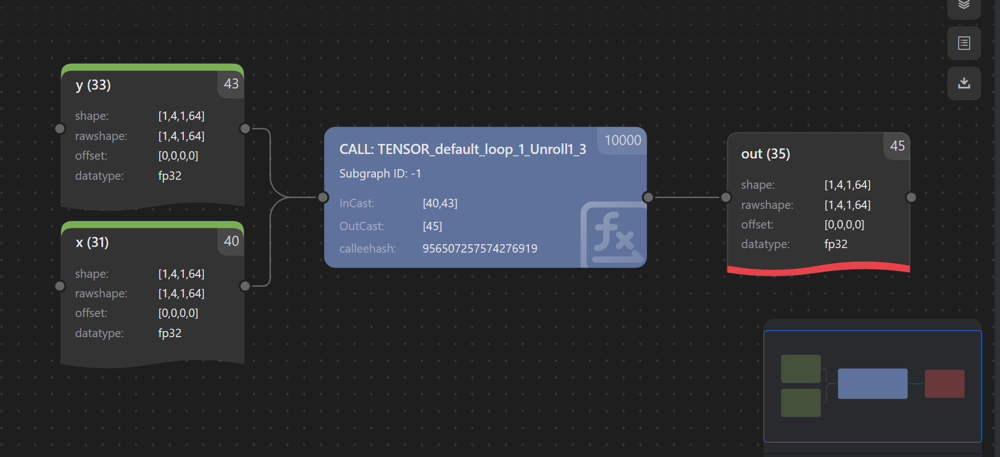

# 如何开始

代码仓库：
https://gitcode.com/cann/pypto

记得先根据pypto/examples/README.md，进行环境准备、软件安装和运行前配置。

**注意：**
CANN 9.0.0 与 PyPTO 0.3.0 的版本不匹配。

| CANN 版本   | 对应的 PyPTO 版本     |
| --------- | ---------------- |
| 9.0.0     | 0.2.0            |
| 9.1.0 及之后 | 已集成 PyPTO，无需单独编译 |

所以如果用的CANN是9.0.0，不能使用主分支的pypto，要先将分支切到v0.2.0
```
git checkout r0.2.0
```
(当然也可以把cann升级到9.2.0)
# 开始运行
## 00_hello_world
hello_world.py
编译输出
```
============================================================
PyPTO hello_world Example
============================================================

Running Example hello_world::test_add_direct: hello_world
Start time: 2026-10-30 02:26:51
Total Core:73
Total Task Count:1
|--Fake Task Count:0
Parse Swim json and Topo json Data End

-------- AICORE Prof Summary --------
AICore End-to-End Time: 1.87
AICore Utilization:     1.39%
-------------------------------------
Generate Bubble Analysis Report: /mnt/workspace/gitCode/pypto/examples/00_hello_world/output/output_20261030_102638_784416_49116_C0A85CC6/CostModelSimulationOutput/bubble_analysis.log
Convert To perfetto trace End
Open the trace at https://ui.perfetto.dev/ 
Output:  /mnt/workspace/gitCode/pypto/examples/00_hello_world/output/output_20261030_102638_784416_49116_C0A85CC6/CostModelSimulationOutput/merged_swimlane.json
End time: 2026-10-30 02:26:51
Time taken: 0 secs
Input0 shape: torch.Size([1, 4, 1, 64])
Input1 shape: torch.Size([1, 4, 1, 64])
Output shape: torch.Size([1, 4, 1, 64])
✓ Hello world example passed
```
使用pypto toolkit插件打开运行结果output下的program.json，即可得到计算图

## 01_beginner
### basic
#### basic_ops.py
这个文件下有五个测试：
##### 1.  Tensor Creation
测试创建tensor
##### 2.  Element-wise Operations：
```
# 即时编译（JIT）装饰器
@pypto.frontend.jit(runtime_options={"run_mode": global_run_mode}) 
def elementwise_kernel(
    a: pypto.Tensor([], pypto.DT_FP16),
    b: pypto.Tensor([], pypto.DT_FP16),
    out: pypto.Tensor([], pypto.DT_FP16)):
    
    # 把数据切成 8x8 的块（Tile），放进向量计算单元（Vector Core）里处理
    pypto.set_vec_tile_shapes(8, 8) 
    
    # (a + b) * 2.0,生成算子融合，最后结果搬运
    out.move(pypto.mul(pypto.add(a, b), 2.0)) 
```
这部分测试了：**编译器指令下发 -> 内存分配 -> 数据切分 -> 向量计算 -> 数据回写 -> 精度校验** 这一整套最基础、也是最关键的全链路流程。如果这个测试跑通了，说明 PyPTO 环境、CANN 驱动、NPU 硬件全部连接正常，可以开始搞更复杂的矩阵乘法（MatMul）或注意力机制（Attention）了。
##### 3. Matrix Multiplication
```
@pypto.frontend.jit(runtime_options={"run_mode": global_run_mode})
def matmul_kernel(
    a: pypto.Tensor([], pypto.DT_BF16),
    b: pypto.Tensor([], pypto.DT_BF16),
    out: pypto.Tensor([], pypto.DT_BF16)):
    pypto.set_cube_tile_shapes([32, 32], [64, 64], [64, 64])
    out.move(pypto.matmul(a, b, a.dtype))
```
这个是矩阵乘法示例。
这里的`set_cube_tile_shapes` 针对矩阵单元的tiling模块，前面的`set_vec_tile_shapes`是针对向量单元的。
##### 4. Reduction Operations
```
pypto.sum(a, dim=-1, keepdim=False)
```
归约操作示例，即按最后一维求和。
##### 5. Tiling Configuration
```
pypto.set_vec_tile_shapes(2, 8)
```
切分操作示例。`set_vec_tile_shapes` 就可以干预底层硬件的切分策略（对应向量计算）；如果是矩阵乘，就用 `set_cube_tile_shapes`。
##### 6. Transform Operations (view + assemble)
```
@pypto.frontend.jit(runtime_options={"run_mode": global_run_mode})
def view_assemble_kernel(
    x: pypto.Tensor(),
    output: pypto.Tensor(),
    tile_h: int,
    tile_w: int,
    height: int,
    width: int):
    pypto.set_vec_tile_shapes(tile_h, tile_w)
    h_tiles = height // tile_h
    w_tiles = width // tile_w
    for h_idx in pypto.loop(h_tiles, name="h_loop", idx_name="h_idx"):
        for w_idx in pypto.loop(w_tiles, name="w_loop", idx_name="w_idx"):
            h_off = h_idx * tile_h
            w_off = w_idx * tile_w
            tile = pypto.view(x, [tile_h, tile_w], [h_off, w_off])
            result = pypto.mul(tile, 2.0)
            pypto.assemble(result, [h_off, w_off], output)
```
展示了PyPTO 编译器中非常核心的数据切片（View）与原地拼接（Assemble）机制，以及手动控制循环（Manual Tiling）的能力。
- **`pypto.view(x, [tile_h, tile_w], [h_off, w_off])`**：  
    类似PyTorch 里的 `x[h_off:h_off+tile_h, w_off:w_off+tile_w]`。但在 NPU 底层，这是一个**DMA（直接内存访问）搬运指令**。它告诉硬件：“去全局内存（HBM）的 `(h_off, w_off)` 坐标处，挖出一块 `tile_h*tile_w`大小 的数据，搬进片上缓存。”
- **`pypto.assemble(result, [h_off, w_off], output)`**：  
    把算好的结果，放到输出张量 `output` 的对应位置。这也是一个 DMA 写回指令。
- 为什么需要手写嵌套的 `for` 循环而不是用`out.move`？（Manual Tiling）
	在之前的例子中，一个 `out.move(...)` 就搞定了所有事情。但在真实的极致性能优化中，开发者往往需要精确控制计算流。
	- 代码里的两个 `pypto.loop`（外层 `h_loop`，内层 `w_loop`）构成了对 `height*width`（64x64） 大小矩阵的遍历。
	- 由于设置 `tile_h=32, tile_w=32`，这个循环会执行 2×2=42×2=4 次。
	- 测试目的：测试编译器能否正确解析嵌套的硬件循环，并准确计算每一次迭代时的内存偏移量（Offset）（即 `h_off` 和 `w_off`）。