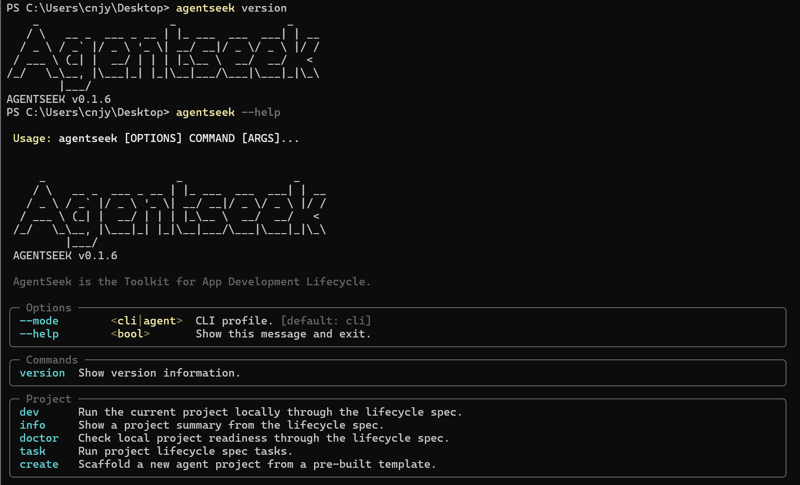
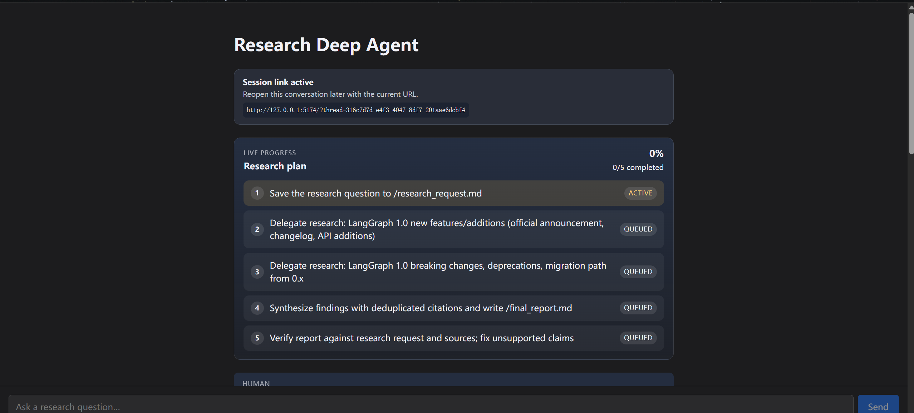

课程地址：
https://datawhalechina.github.io/deepagents-in-action/chapters/pre01-agentseek-create/

个人项目代码：
https://github.com/Coyilla/deepagents-in-action-labs

# 1 问题：清华镜像源返回了 `403 Forbidden`
问题一：
```
PS C:\Users\cnjy\Desktop> uv tool install --upgrade agentseek
  × No solution found when resolving dependencies:
  ╰─▶ Because agentseek was not found in the package registry and you require agentseek, we can conclude that your
      requirements are unsatisfiable.

hint: An index (https://pypi.tuna.tsinghua.edu.cn/simple) returned a 403 Forbidden error. Check that the index URL is correct and the credentials are valid.
```
原因：
清华镜像源返回了 `403 Forbidden`，导致 uv 无法正常查询包注册表；而 `agentseek` 这个包名在 PyPI 上的状态也容易造成混淆。
解决办法：
```
// 临时覆盖UV_DEFAULT_INDEX为官方PYPI
$env:UV_DEFAULT_INDEX = "https://pypi.org/simple"
// 缓存中可能还保留着之前从清华镜像获取的失败记录，清除它可以让 uv 重新开始
uv cache clean
// 重新下载
uv tool install --upgrade agentseek
```
重启powershell并检查


# 2 探究：agentseek create --list-templates --checkout main命令在干什么
```
agentseek create --list-templates --checkout main
```
这个命令到底在干什么？
作用：**AgentSeek 命令行工具列出的可用项目模板清单**。
它的核心意思是：
1. **`agentseek create`**：用 AgentSeek 创建一个新 Agent 项目。
2. **`--list-templates`**：不是马上创建，而是先“列出所有可用模板”。
3. **`--checkout main`**：大概表示从 `main` 分支/版本获取模板列表或模板代码（具体以 AgentSeek 文档为准）。
输出：
```
PS E:\MyProject\AgentSeek> agentseek create --list-templates --checkout main

  bub (1 templates)
  ────────────────────────────────────────────────────────────
    bub/default
      Lightweight Bub agent with AgentSeek lifecycle spec.

  deepagents (9 templates)
  ────────────────────────────────────────────────────────────
    deepagents/content-builder
      DeepAgents content builder with skills, subagents, image generation, streamed UI, and AgentSeek lifecycle spec.
    deepagents/context-engineering
      Bilingual Deep Agents Compare with discovered or manually selected models, shared task and memory snapshots, independent context graphs, Querit search, and opt-in LangSmith traces.
    deepagents/default
      Local create_deep_agent runnable with AgentSeek lifecycle spec.
    deepagents/mcp
      DeepAgents MCP Tools app with validated stdio/HTTP configuration, a local calculator example, streamed UI, and AgentSeek lifecycle spec.
    deepagents/powercontext
      Deep Agents release assistant with PowerContext Memory on embedded seekdb, fresh-conversation recall comparisons, and inspectable bounded context.
    deepagents/research
      DeepAgents research agent with Tavily search, streamed tool/sub-agent UI, and AgentSeek lifecycle spec.
    deepagents/sandbox
      DeepAgents sandbox coding agent with streamed UI and AgentSeek lifecycle spec.
    deepagents/streaming
      DeepAgents Event Streaming v3 showcase with subagent, message, tool, state, and output projections.
    deepagents/subagents-dynamic
      Dynamic Subagents Pattern Lab with six independent official-pattern assistants, evidence-driven execution UI, and AgentSeek lifecycle spec.

  langchain (10 templates)
  ────────────────────────────────────────────────────────────
    langchain/agentbase-rag-agentops
      LangChain RAG backed by AgentBase knowledge-base search with AppBase AgentOps observability and AgentSeek lifecycle spec.
    langchain/agentic-rag
      LangChain agentic RAG with OceanBase vector search and AgentSeek lifecycle spec.
    langchain/agentic-rag-hybrid
      LangChain agentic hybrid RAG with image ingestion, vector/sparse/full-text/metadata search, comparison demos, optional Phoenix observability, and AgentSeek lifecycle spec.
    langchain/agentic-rag-openvino
      LangChain local RAG with OpenVINO models and AgentSeek lifecycle spec.
    langchain/cli-remote
      Remote LangGraph CLI agent bridged through LangGraphClientRunnable with AgentSeek lifecycle spec.
    langchain/default
      LangChain create_agent plus CopilotKit middleware with AgentSeek lifecycle spec.
    langchain/jev-harness
      LangChain harness with selectable System One decision models (official Jev by default), model routing, context-sensitive Auto Mode gating, a two-model Arena, and bilingual decision evidence.
    langchain/markdown-messages
      LangChain create_agent and react-markdown frontend with AgentSeek lifecycle spec.
    langchain/relay-observability
      LangChain Relay observability with bounded Tavily research, Phoenix, OceanBase SeekDB, and AgentSeek lifecycle spec.
    langchain/rubric
      LangChain create_agent with evidence-backed rubric revision, Guided Demo and Live Model UI, and AgentSeek lifecycle spec.

  Usage:
    agentseek create <type>/<name>       e.g. agentseek create bub/default
    agentseek create <type>              use default template for the type
    agentseek create                     interactive selection
```
1. 输出里按模板类别分组：
    - `bub`：1 个模板
    - `deepagents`：9 个模板
    - `langchain`：10 个模板
2. 每个模板下面的英文是说明，比如：
    - `deepagents/default`：本地 DeepAgent 默认模板
    - `deepagents/research`：带 Tavily 搜索的研究型 Agent
    - `langchain/agentic-rag`：基于 OceanBase 向量搜索的 LangChain RAG
    - `langchain/default`：LangChain 默认 Agent 模板
3. 最后 `Usage` 是用法：
```
    agentseek create <type>/<name>
```
    例如：
```
    agentseek create bub/default
    agentseek create deepagents/research
    agentseek create langchain/default
```
    也可以只写类型，用该类型的默认模板：
```
    agentseek create deepagents
    agentseek create langchain
```
    或者直接：
```
    agentseek create
```
    进入交互式选择。

# 3 探究： agentseek info 在干什么
```
agentseek info
```
在干什么：提供项目信息。
```
PS E:\MyProject\AgentSeek\research_deepagent> agentseek info

// 提供项目基本信息，例如根目录，项目名（默认），模板类型，生命周期规范文件地址及版本
Project 
  Root: E:\MyProject\AgentSeek\research_deepagent
  Name: Research DeepAgent
  Template: deepagents/research
  Lifecycle: .agentseek\lifecycle.toml / version 2

// 入口/启动地址
// 开发时用agentseek dev启动
// 后端Agent服务（LangGraph API）跑在127.0.0.1:2024
// 前端（Vite）跑在127.0.0.1:5174
Entrypoints
  Dev: agentseek dev 
  Langgraph: http://127.0.0.1:2024 (runtime: agentseek-api)
  Frontend: http://127.0.0.1:5174 (runtime: vite)

// 环境变量状态
// 包括环境文件.env，模型提供，api key等等，当前都是默认状态（未设定）
Environment
  Env file: .env (missing)
  SEEKDB_EMBED: set (default)
  SEEKDB_EMBED_DIR: set (default)
  OCEANBASE_DB_NAME: set (default)
  AGENTSEEK_MODEL_PROVIDER: set (default)
  AGENTSEEK_MODEL: set (default)
  OPENAI_API_KEY: missing
  TAVILY_API_KEY: missing
  LANGCHAIN_OPENAI_STREAM_CHUNK_TIMEOUT_S: set (default)

// 可执行任务
// 这些是模板预置的常用任务，可以用agentseek task <名字>执行
Lifecycle Tasks
  sync: Install Python dependencies with uv.
  frontend: Install frontend dependencies.
  course-check: Run model-free course graph and artifact checks.

// 下一步建议
Next
  agentseek task --list //查看所有任务
  agentseek doctor //做环境/依赖诊断
  agentseek dev //启动开发环境
```
# 4 问题：前端依赖配置失败
**问题：**
```
PS E:\MyProject\AgentSeek\research_deepagent> agentseek task frontend
npm error code ENOENT
npm error syscall open
npm error path E:\MyProject\AgentSeek\research_deepagent\package.json
npm error errno -4058
npm error enoent Could not read package.json: Error: ENOENT: no such file or directory, open 'E:\MyProject\AgentSeek\research_deepagent\package.json'
npm error enoent This is related to npm not being able to find a file.
npm error enoent
npm error A complete log of this run can be found in: C:\Users\cnjy\AppData\Local\npm-cache\_logs\2026-11-16T09_56_36_305Z-debug-0.log
```
**原因：**
`agentseek task frontend` 实际执行的是 `npm install --prefix frontend`。这个写法在 npm 版本/环境下有问题：npm 会先在当前工作目录（项目根，没有 `package.json`）找 `package.json`，然后直接报 ENOENT，`--prefix frontend` 还没来得及生效。这是 npm 对 `install --prefix` 这种"局部参数"处理不稳定的典型表现。
**直接解决方案**：手动装前端依赖
```
cd frontend
npm install
```
**又出问题**：
```
PS E:\MyProject\AgentSeek\research_deepagent\frontend> npm install npm error Cannot read properties of null (reading 'edgesOut') npm error A complete log of this run can be found in: C:\Users\cnjy\AppData\Local\npm-cache\_logs\2026-11-16T09_59_00_891Z-debug-0.log
```
`Cannot read properties of null (reading 'edgesOut')` 是 npm 10（Node 22 默认自带的版本）在解析依赖树时的一个内部崩溃。它通常由某些包的 peer 依赖（peer dependency）冲突触发——特别是当依赖树里出现版本不匹配的 `vitest` 时，npm 10 会去读取一个已经不存在的节点，从而报出这个 `null` 错误。
npm 11 已经修复了这个问题，所以官方推荐的方案就是**升级 npm**。
```
cd frontend
npm install -g npm@11
npm install
```

# 5 wsl环境与powershell环境
在windows的powershell下下载的命令，wsl环境中得重新下载一遍。

# 6 问题：后端启动失败
后端启动失败
```
fail langgraph: http://127.0.0.1:2024/health is not reachable.
     next: Start the local app with `agentseek dev`.
```
```
Timed out waiting for 'http://localhost:2024' to become ready: <urlopen error timed out>
[sample_graphs] skipped store_memory: No module named 'graphs'
[sample_graphs] skipped stress_test: No module named 'graphs'
[sample_graphs] skipped subgraph_agent: No module named 'graphs'
[sample_graphs] skipped react_agent: No module named 'graphs'
[sample_graphs] skipped stress_tool_agent: No module named 'graphs'
[sample_graphs] skipped subgraph_hitl_agent: No module named 'graphs'
```

根本原因：项目放在了 `/mnt/c/` 下

这是 WSL 用户最容易踩的坑。DataWhale 教程明确建议，项目应放在 Linux 文件系统（如 `~/projects/`）下，不要放在 `/mnt/c/` 下。
如果 `research_deepagent` 项目是通过 `/mnt/c/Users/...` 这类 Windows 路径访问的，可能会导致：
- 文件系统性能问题或权限问题。
- Python 模块导入路径解析异常，从而引发 `No module named 'graphs'` 错误。

解决方法：将整个项目移动到 `~/projects/` 目录下再重试

也是改了一个下午+晚上才发现问题改过来。另外wsl最好改成mirrored模式。

# 终于成功了
