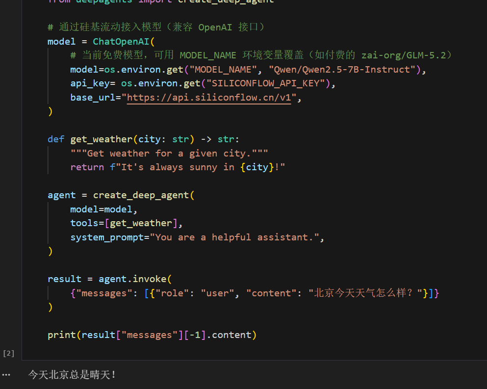
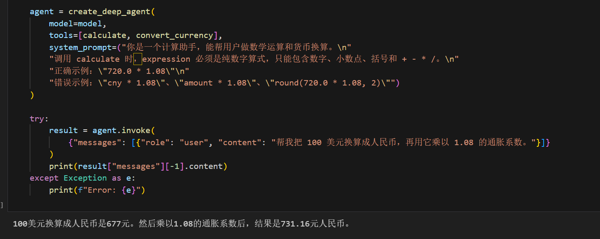
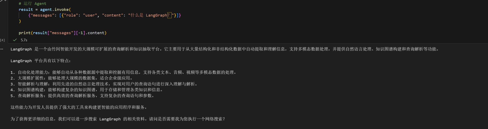
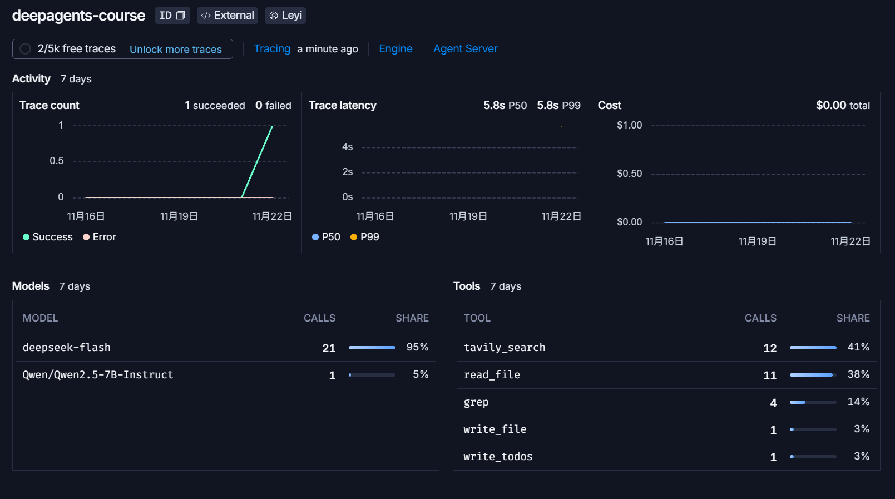
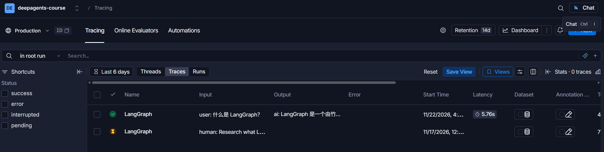

# 课程地址：
https://datawhalechina.github.io/deepagents-in-action/chapters/ch01-agent-harness/
https://datawhalechina.github.io/deepagents-in-action/chapters/ch02-quickstart/

# 个人项目代码：
https://github.com/Coyilla/deepagents-in-action-course/blob/master/ep02_helloworld.ipynb

# task2任务
## 任务一：跑通hello world（天气假工具）

## 任务二：货币单位转换器

## 任务三：搜索工具

## LangSmith，看一次完整 Trace

