# 前言
课程内容：
https://datawhalechina.github.io/deepagents-in-action/chapters/ch03-virtual-filesystem/
这一章的内容很理论。
另外还看了官方的实验内容：
https://github.com/agentseek-ai/agentseek-templates/tree/main/templates/deepagents/content-builder
但是好像内容有点多。

这一章的个人实验项目代码：
https://github.com/Coyilla/deepagents-in-action-course/blob/master/ep03_virtualfilesystem.ipynb

# 实验部分
## step1：体验Agent 自带文件柜 （write_file / read_file / grep）

默认创建 create_deep_agent() 时，它自带了 7 个文件工具（ls, read_file, write_file, edit_file, glob, grep, execute），且默认使用 StateBackend（存在内存的 Graph State 里）。

```
import os
from dotenv import load_dotenv
from langchain_openai import ChatOpenAI
from deepagents import create_deep_agent

load_dotenv()

# 这里以 DeepSeek 为例，你也可以换成你平时用的模型
model = ChatOpenAI(
    model="deepseek-chat",
    api_key=os.getenv("DEEPSEEK_API_KEY"),
    base_url="https://api.deepseek.com",
)

# 不传 backend 参数，默认就是 StateBackend
agent = create_deep_agent(model=model)

prompt = """
请依次完成以下三个操作：
1. 使用 write_file 在虚拟目录下创建一个 `/notes/architecture.md`，写入关于“多Agent系统状态隔离与因果图一致性”的三点设计原则。
2. 使用 grep 在 `/notes` 目录下搜索包含“状态”二字的内容。
3. 使用 read_file 读取 `/notes/architecture.md` 的完整内容并总结给我。
"""

res = agent.invoke({"messages": [("user", prompt)]})
print(res["messages"][-1].content)
```
执行结果：
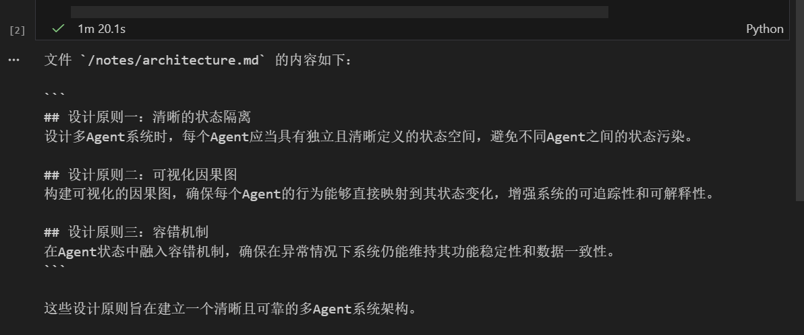
完整过程
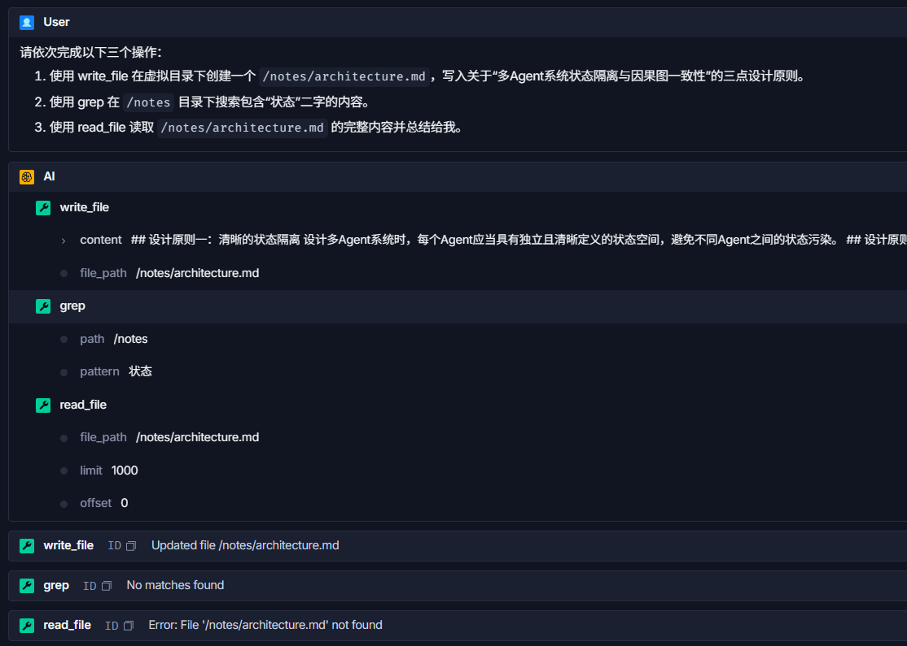
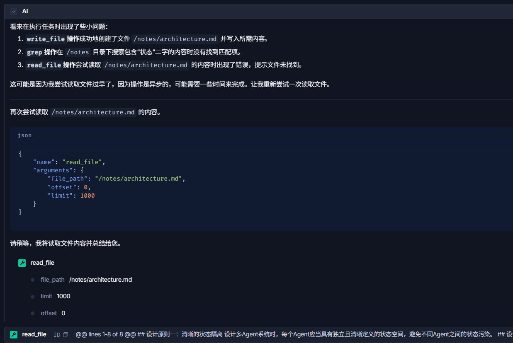
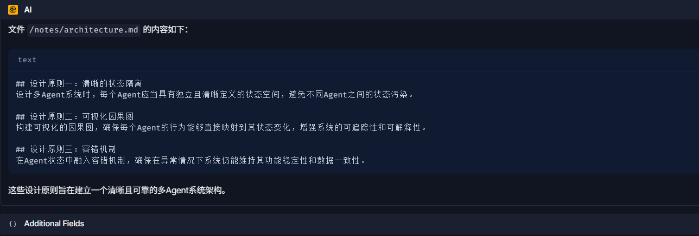
工具调用具体过程：
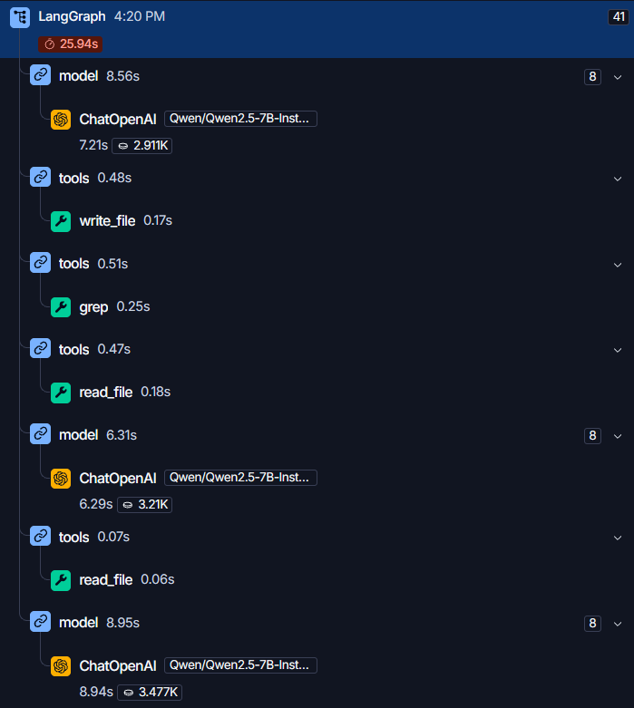
## step2: 上下文自动管理的大结果卸载
当工具返回的字符串超过一定长度（deepagents 默认阈值通常在几万字符 / ~20k tokens 左右）时，中间件不会把几万字直接塞进对话历史撑爆上下文，而是自动将其写入虚拟文件，并在对话历史里只保留文件路径 + 首尾预览。
下面的代码自定义一个返回超长文本的工具：
```
import os
from dotenv import load_dotenv
from langchain_core.tools import tool
from langchain_openai import ChatOpenAI
from deepagents import create_deep_agent

load_dotenv()

@tool
def fetch_huge_logs(query: str) -> str:
    """模拟检索海量系统日志，返回超大文本结果"""
    # 制造约 15 万字符的日志（远超卸载阈值）
    lines = [f"[2026-11-25 10:00:{i%60:02d}] INFO module_core - trace_id={i} status=OK payload=normal_data_stream" for i in range(2500)]
    lines[1234] = "[2026-11-25 10:20:34] ERROR module_auth - CRITICAL_TOKEN_LEAK_DETECTED user_id=9527"
    return "\n".join(lines)

model = ChatOpenAI(
    model="deepseek-chat",
    api_key=os.getenv("DEEPSEEK_API_KEY"),
    base_url="https://api.deepseek.com",
)

agent = create_deep_agent(model=model, tools=[fetch_huge_logs])

res = agent.invoke({
    "messages": [("user", "调用 fetch_huge_logs 查询系统日志，然后找出里面唯一报错的 ERROR 那一行（提示：可以用 grep 工具去搜卸载后的文件）。")]
})
print(res["messages"][-1].content)
```
执行结果：查询成功
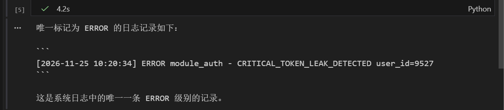
调用完整过程
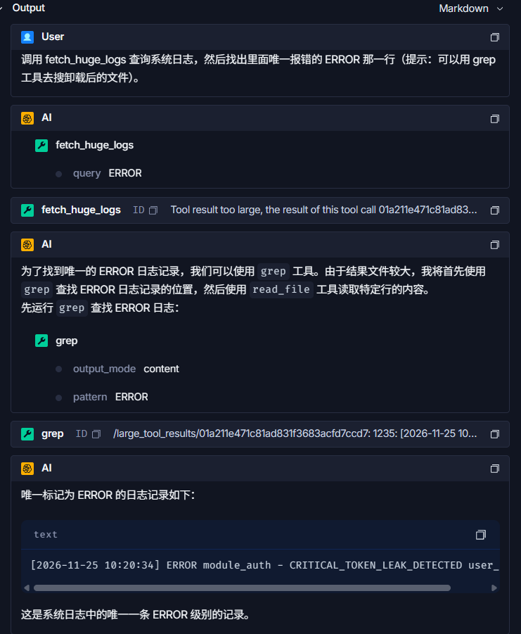
工具调用摘要：
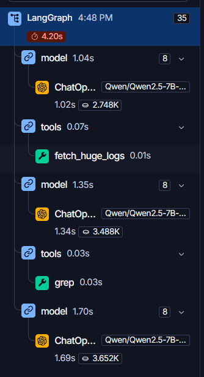

## step3: 两种 Backend 对比实验（`StateBackend` vs `FilesystemBackend`）
对比最直观的 **`StateBackend`（内存草稿纸）** 和 **`FilesystemBackend`（本地真磁盘）**
用以下代码跑两次对比：
```
import os
from dotenv import load_dotenv
from langchain_openai import ChatOpenAI
from deepagents import create_deep_agent
from deepagents.backends import StateBackend, FilesystemBackend

load_dotenv()

model = ChatOpenAI(
    model="deepseek-chat",
    api_key=os.getenv("DEEPSEEK_API_KEY"),
    base_url="https://api.deepseek.com",
)

# === 实验 A：StateBackend（默认，内存状态） ===
print("--- 运行 StateBackend ---")
agent_state = create_deep_agent(
    model=model,
    backend=lambda rt: StateBackend(rt)
)
agent_state.invoke({"messages": [("user", "用 write_file 写入 /test_state.txt，内容为 'hello state'")]})
# 新建一次 invoke（新会话/重启），让它去读刚才的文件
res_a = agent_state.invoke({"messages": [("user", "用 read_file 读取 /test_state.txt")]})
print("StateBackend 新会话读取结果：", res_a["messages"][-1].content)


# === 实验 B：FilesystemBackend（落盘到本地真实目录） ===
print("\n--- 运行 FilesystemBackend ---")
os.makedirs("./agent_workspace", exist_ok=True)
agent_fs = create_deep_agent(
    model=model,
    # virtual_mode=True 会把 Agent 视角里的 '/' 映射到本地的 './agent_workspace'
    backend=FilesystemBackend(root_dir="./agent_workspace", virtual_mode=True)
)
agent_fs.invoke({"messages": [("user", "用 write_file 写入 /test_fs.txt，内容为 'hello disk'")]})
# 即使重新创建一个全新的 agent 实例（模拟进程重启），再去读：
agent_fs_restarted = create_deep_agent(
    model=model,
    backend=FilesystemBackend(root_dir="./agent_workspace", virtual_mode=True)
)
res_b = agent_fs_restarted.invoke({"messages": [("user", "用 read_file 读取 /test_fs.txt")]})
print("FilesystemBackend 重启后读取结果：", res_b["messages"][-1].content)
```
执行结果：
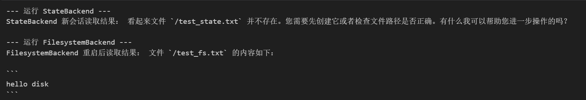
实验A中第一次调用agent：
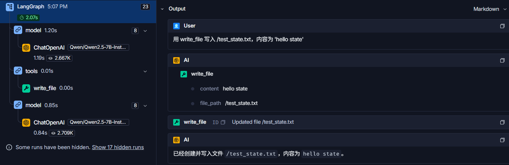
实验A中第二次调用agent：
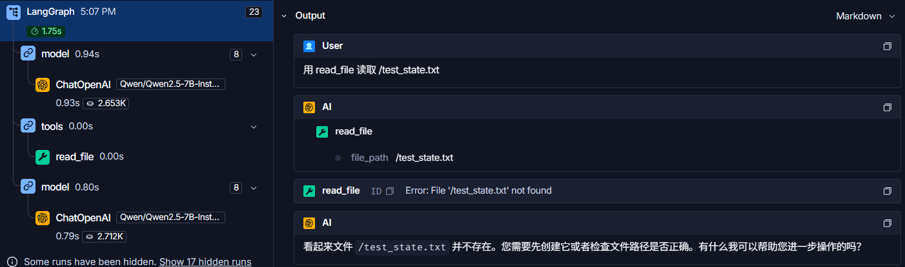
实验B中第一次调用agent：
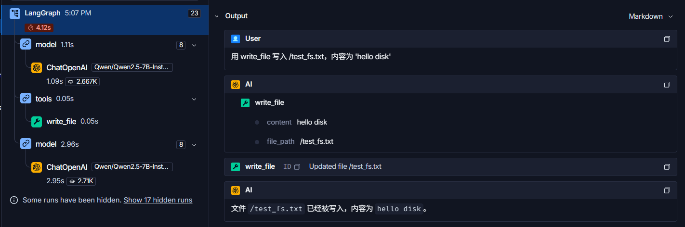
实验B中第二次调用agent：
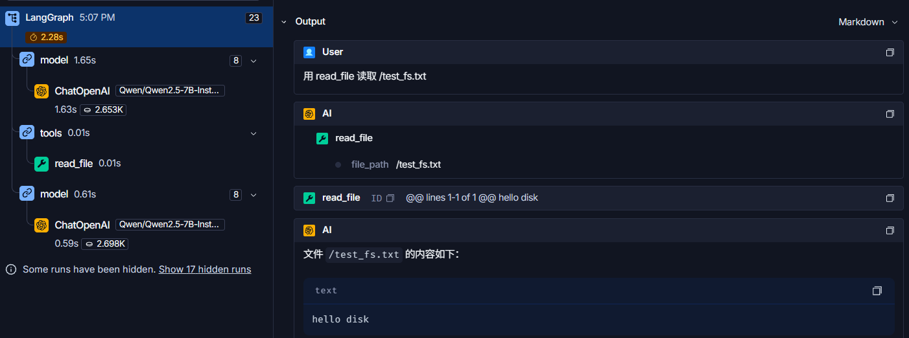
同时实验B创建的文件也存在，vscode可以打开查看

对比表格

| **对比维度**          | **StateBackend（默认）**        | **FilesystemBackend**                                         |
| ----------------- | --------------------------- | ------------------------------------------------------------- |
| **实际存储位置**        | LangGraph 的运行状态（内存字典）       | 本地真实硬盘（指定的 `root_dir` 文件夹下，如 `./agent_workspace/test_fs.txt`） |
| **会话结束/进程重启后**    | **丢失**（仅在单次 Thread 状态快照内有效） | **依然存在**（直接落盘为物理文件，重启进程仍可读取）                                  |
| **本地资源管理器能否直接看到** | 看不到                         | 可以直接用 VS Code / 记事本打开查看和编辑                                    |
| **适用场景**          | 单次任务的临时草稿、大工具结果的自动卸载缓存      | 本地代码助手、自动化写文章/报告（如 `content-builder` 模板）、需要人类介入审阅产物的场景        |

